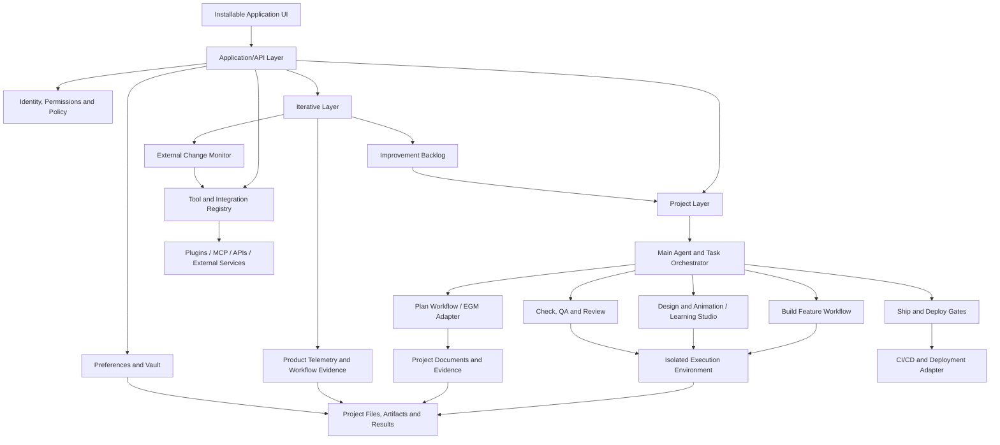

# System Architecture

**Status:** Proposed logical architecture; implementation choices remain open.  
**Document role:** Defines logical components, responsibilities, trust boundaries, and interactions.  
**Related documents:** [Product Vision](PRODUCT_VISION.md) · [Functional Requirements](FUNCTIONAL_REQUIREMENTS.md) · [Tool Registry](TOOL_REGISTRY.md) · [Implementation Roadmap](IMPLEMENTATION_ROADMAP.md)

## 1. Architectural goals

- Support an installable application for creating and managing software projects.
- Keep Project Layer execution separate from Iterative Layer analysis and improvement planning.
- Coordinate agents with a clear main-agent responsibility and bounded delegated tasks.
- Make workflows traceable, observable, resumable, and testable.
- Connect to external tools using replaceable adapters and least-privilege credentials.
- Allow the system to assess imported repositories and connected services without pretending it can see inaccessible systems.
- Support controlled self-improvement without allowing the live application to modify itself directly.

## 2. Logical architecture

This is a logical model, not a commitment to a specific framework, database, deployment platform, or process boundary. The concrete architecture must be selected after the target operating systems, execution model, privacy expectations, and budget are decided.

## 3. Major components

### 3.1 Installable application shell

Provides navigation, project selection, workflow status, approvals, tool settings, session history, improvement backlog, and evidence/report viewing. The shell should not contain the core orchestration logic directly; it should call application services through defined interfaces.

The shell should implement a consistent design system influenced by the reference images in `design-references/`: persistent navigation, a clear top-level utility/header area, a primary work surface, and contextual side panels or cards when they improve the task. File-heavy areas such as Learning Studio should support searchable collections, nested folders or equivalent grouping, file lists, metadata, previews, and useful empty states. Do not force every screen into the same card layout if a table, tree, editor, or timeline is more appropriate.

Use shared design tokens and reusable components for colour, typography, spacing, surfaces, borders, focus states, elevation, and interaction feedback. The initial theme direction is dark navy/near-black with restrained blue and violet accents; support a light theme or theme preference where practical. Keep the UI responsive and keyboard-accessible, provide visible focus, preserve sufficient contrast, and respect reduced-motion preferences. Visual references are guidance rather than a mandate to copy exact layouts, logos, text, or branding. The presentation layer must remain separate from orchestration and business rules.

### 3.2 Application/API layer

Provides validated operations for projects, workflows, files, integrations, approvals, users/settings if supported, and reporting. It handles request validation, permission checks, error mapping, and audit events. UI controls are not security boundaries: authorization must be enforced in the application/backend layer.

### 3.3 Project Layer

Owns project-specific state, specifications, tasks, code execution, design references, test evidence, review findings, deployment readiness, and release history. Each project should have an isolated working directory or equivalent workspace and a record of its connected external services.

Project workflows:

1. Plan
2. Build
3. Design & Animation
4. Check & Review
5. Ship & Deploy

The workflow engine should enforce entry/exit conditions while allowing a user to return to earlier phases when findings require it.

### 3.4 Iterative Layer

Consumes application-level telemetry, feedback, workflow outcomes, tool inventory, and external change events. It creates prioritised proposals and tracks their implementation and outcomes.

It should initially operate in **observe and recommend** mode. Approved proposals can be routed to the Project Layer as platform-maintenance projects. Deployment of a modified version of the application must go through release gates; the running instance must not write directly to its production executable or production configuration.

### 3.5 Main agent and task orchestrator

The main agent translates a request into a task plan, selects tools and execution strategy, delegates bounded tasks, tracks status, reconciles results, and reports the final outcome. A deterministic orchestration service should enforce policy, permissions, timeouts, budget limits, and workflow states; the language model should not be the sole enforcement mechanism.

#### Agent-selection policy

Use a **single agent** when:

- The task is small, sequential, and tightly coupled.
- One context is sufficient and delegation would add more overhead than value.
- The task requires a single coordinated edit or a clear answer.

Use a **subagent** when:

- A bounded task can be investigated or performed independently.
- A specialist perspective is useful, such as security review, test review, architecture analysis, or documentation analysis.
- The output can be returned as a report or small deliverable for the main agent to reconcile.

Use an **agent team** when:

- Multiple workstreams can proceed in parallel and have sufficiently separate ownership.
- The task is large enough that parallel work saves meaningful time or improves coverage.
- There is a clear integration plan, defined interfaces, and a coordinator who can resolve conflicts.

Default to the simplest option. Do not launch a team just because a task is described as complex. Estimate parallelism, risk, coordination cost, context overhead, tool permissions, and budget. If parallel tasks would edit the same files or need frequent shared decisions, use sequential work or explicit ownership boundaries instead.

The orchestrator should record the chosen strategy and a brief rationale. For high-impact actions, explicit approval rules take precedence over the agent's strategy choice.

### 3.6 Tool and integration registry

Stores each proposed or installed tool's identity, type, source, version, status, compatibility, permissions, required credentials, data access, cost considerations, owners, dependent workflows, and verification evidence. The Tool Registry document describes the initial inventory schema and candidate tools.

Use adapters to isolate vendor-specific operations. A workflow should request a capability such as `run_browser_qa` or `deploy_preview` through a documented interface rather than directly assuming a particular plugin's command exists.

### 3.7 Preferences and Vault

Stores approved user preferences, project-specific decisions, reference materials, session summaries, and reusable learning notes. Global preferences and project-specific context must remain distinct. Entries should retain provenance, creation/update date, scope, and a way to review or remove them.

### 3.8 Learning Studio

A design-reference workspace for importing screenshots, visual files, animation examples, short videos, and related material. Ingested material should be tagged and explained, and the user should be able to inspect it in a viewer. Reference material is guidance, not authority to overwrite project requirements or copy unsafe content.

### 3.9 Evidence and artifact store

Stores project documents, task plans, command outputs, test results, screenshots, review findings, deployment reports, improvement proposals, and change-monitoring records. Records should be linked to project, workflow run, requirement, tool version, and relevant commit or release where available.

### 3.10 Telemetry and update monitor

Collects privacy-appropriate metrics about workflow outcomes, errors, latency, retries, usage, cost, manual interventions, and tool failures. The update monitor tracks trusted release sources and maps discovered changes to the tool registry and dependent workflows.

### 3.11 Tool conflict and lifecycle manager

Provides inventory, conflict analysis, disable/uninstall planning, and post-change verification for plugins, skills, local mods, hooks, MCP servers, CLI tools, and related configuration managed by or connected to the application. It works with the Tool Registry rather than maintaining a second, conflicting source of truth.

The manager should:

- Record installation scope and provenance where discoverable (for example, project-local, user-level, account-level, marketplace-managed, package-manager-managed, or unknown).
- Detect duplicate commands/skills, overlapping capabilities, incompatible versions, conflicting hooks or configuration, duplicate MCP tool names, missing dependencies, and tools that depend on one another.
- Classify findings as informational overlap, potential conflict, confirmed conflict, or release-blocking conflict, with evidence and confidence.
- Map each candidate removal to workflows, agents, projects, and integrations that may be affected.
- Prefer non-destructive remediation when sufficient, including configuration changes, disabling a tool, or switching off one integration.
- Use a supported native uninstall or disable mechanism where available. Do not blindly delete paths or infer ownership from a matching name alone.
- Generate a dry-run plan and show affected components, actions, backup/recovery options, and expected consequences before executing a destructive operation.
- Require explicit approval for removal of user/account-level tools, shared dependencies, hooks, MCP configurations, or anything with uncertain ownership or broad impact.
- Preserve a restorable snapshot of relevant configuration where practical, record an audit event, and verify the resulting tool inventory and affected workflows.
- If safe ownership or removal cannot be established, stop and provide evidence-based manual instructions instead of attempting deletion.

The intended flow is:

`Inventory → Detect conflicts → Map dependencies and scope → Recommend resolution → Dry run → Approval → Disable/uninstall → Verify → Record outcome`

The manager must never remove operating-system components, shared runtimes, unrelated applications, credentials, or user-created files merely because they appear adjacent to a conflicting tool. It must not broaden its own permissions to complete a cleanup.

## 4. Workflow state and handoffs

Each workflow run should have a persistent state and structured output. A generic state model is:

`draft → planned → approved → running → verification → awaiting_approval → completed`

Alternative terminal states include `blocked`, `cancelled`, and `failed`. A workflow may return to an earlier phase after a defect or specification discrepancy is found. The exact state model should be implemented explicitly; it must not exist only in a conversational transcript.

A phase handoff should include:

- Objective and scope.
- Relevant approved requirements and specification version.
- Inputs and dependencies.
- Changed files or external resources.
- Tests and evidence produced.
- Open findings, risks, and decisions required.
- The conditions for the next phase to start.

## 5. Planning integration

EGM is a proposed tool integration sourced from `https://egm.dev/` and `https://github.com/google/elephant-goldfish-model`. Create an adapter or workflow wrapper around the installed EGM commands after confirming installation and compatibility. Do not hard-code command names without checking the installed version.

The Plan workflow should output concept and design documents in the project's `docs/designs/` area (or record an approved existing alternative). It must keep the last approved specification version and record approved changes. EGM drift reporting should be invoked after implementation milestones and after later changes that might affect specified behaviour.

## 6. Existing-project import and enterprise assessment

The import/assessment service should inspect local repository content and, only when authorised, external systems connected through configured integrations. It should report findings by capability and evidence source.

Possible statuses:

- `implemented_in_code`
- `configured_externally`
- `partially_present`
- `missing`
- `not_verified`
- `not_applicable`

The application should distinguish observed facts from inferred conclusions. It must not infer that a cloud service is configured simply because deployment code mentions that provider. A live external status requires an authenticated integration or other reliable evidence.

Focused assessments should have an explicit scope and avoid broad scans or data collection outside it.

## 7. Security and trust boundaries

- Treat imported repositories, documents, issue text, prompts, model outputs, retrieved reference material, emails, and external tool responses as untrusted input.
- Keep credentials in a secrets manager or protected OS credential store; do not store secrets in project documents, prompts, logs, screenshots, or generated reports.
- Apply least privilege to MCP servers, plugins, API integrations, and agent tools.
- Separate read-only analysis from write, deployment, billing, account-management, and destructive capabilities.
- Treat plugin/mod/skill removal and configuration cleanup as destructive operations; require a dry run, impact report, scoped approval, and post-removal verification.
- Never delete unmanaged files or remove tools based on name similarity alone; establish provenance and use supported uninstall mechanisms where available.
- Require explicit confirmation for production deploys, destructive migrations, permission changes, credential rotations, external message sending, and other high-impact operations.
- Execute untrusted code in an isolated environment with controlled filesystem, network, and resource access. The isolation model must be selected and tested for the supported platforms.
- Protect audit and workflow records against accidental modification; define retention and access policy.
- Never allow the Iterative Layer to change its own approval rules, widen its own permissions, or bypass security gates without an independently authorised change process.
- Use version pinning, compatibility checks, and staged rollout for external updates where possible.

## 8. Resilience and failure handling

External models, plugins, MCP servers, cloud services, and package sources can fail or change. Each integration should declare timeout, retry, idempotency, error, and recovery behaviour where applicable. Retries should be bounded and should not repeat non-idempotent actions without safeguards.

If a capability is unavailable, the system should mark it unavailable, explain which workflow step is blocked, preserve work already completed, and offer a safe alternative where one exists. It should not silently claim that an unexecuted check passed.

## 9. Observability

Record, as appropriate:

- Workflow and task identifiers.
- Agent strategy, delegated tasks, and completion status.
- Tool/model identifiers and versions when available.
- Duration, retries, failures, token or usage metrics, and cost where available.
- Test and review results.
- Approval decisions and audit events.
- External update detections and compatibility assessments.

Avoid capturing unnecessary source code, personal data, credentials, or full prompt content merely for telemetry. Data collection should be minimised and configurable.

## 10. Decisions required before detailed design

- Desktop/web framework and supported operating systems.
- Local versus remote execution and sandbox implementation.
- Persistence layer and artifact storage.
- Identity and credentials model.
- Agent runtime and supported model providers.
- Integration mechanism policy: native plugin, MCP, API, CLI, or browser automation.
- Telemetry retention, privacy controls, and data residency.
- Packaging, automatic updates, signing, and rollback strategy.
